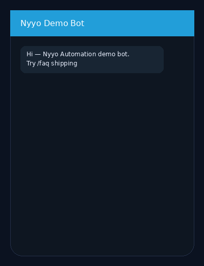

# Telegram demo bot (FAQ · price · cleanup pitch)

> **For non-technical clients — start here**
>
> **What it does:** A Telegram bot that answers common questions (/faq), shows a public price (/price), and explains a service (/clean).
>
> **Try it in 1 click (no Telegram account):** open the [**browser simulator**](https://nyyoautomation.github.io/nyyo-telegram-demo/simulator/), click a command, read the reply.
>
> **Business benefit:** customers get instant answers 24/7 instead of waiting for email. Simple bots from **$79**.



**Simulator (live):** https://nyyoautomation.github.io/nyyo-telegram-demo/simulator/  
**Brand:** [Nyyo Automation](https://github.com/nyyoautomation)

[](#)
[](#)
[](#)

---

## Why no live @bot in this repo?

Hosting a real Telegram bot needs a **BotFather token**. We do **not** create Telegram accounts or store your tokens here (no phone / KYC / secrets in git).  
You (or we, on a paid job) create a dedicated demo bot token and run `bot/demo_bot.py`.

## Run the real bot (optional)

```bash
# 1) Create a bot with @BotFather → copy the token (keep it private)
export TELEGRAM_BOT_TOKEN="your_token_here"
python bot/demo_bot.py
```

## Commands

| Command | Result |
|---|---|
| `/faq shipping\|returns\|pricing\|hours` | Sample FAQ answers |
| `/price btc\|eth\|sol` | Public USD price (CoinGecko) |
| `/clean` | Spreadsheet cleanup pitch |

## What’s for sale

| | |
|---|---|
| **Product** | Custom Telegram / Discord bot (FAQ, alerts, forms) |
| **From** | **$79–200** |
| **Includes** | Source · README · 1 revision |

→ [Packages & contact](https://github.com/nyyoautomation) · [LaborX — Nyyo Automation](https://laborx.com/freelancers/users/id475124)

## Hire me

1. Open an **issue** with: goal · deadline · budget  
2. Or message **[LaborX — Nyyo Automation](https://laborx.com/freelancers/users/id475124)**

Crypto: USDC / SOL / ETH / BTC.
